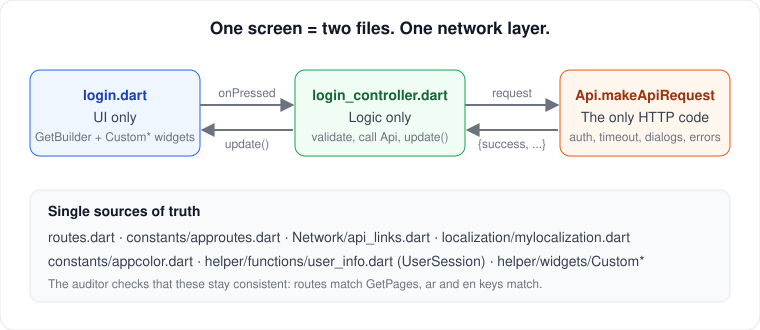

<h1 align="center">Flutter GetX Architecture</h1>
<p align="center"><b>A Claude skill that makes Flutter + GetX projects consistent, reviewable and easy to scale.</b></p>

<p align="center">
  <a href="https://github.com/AdhamAlbanna/claude-skill-flutter-getx/actions/workflows/ci.yml"></a>
  <a href="LICENSE"></a>
  
  
</p>

<p align="center"></p>

## Why this exists

GetX apps tend to rot in the same few ways: logic leaks into widgets, HTTP calls get copied into controllers, and nobody knows where a route, a color or a string lives. This skill gives Claude a small set of conventions that prevent each of those, and the tools to apply and check them:

| Problem | The rule that prevents it |
|---|---|
| Logic mixed into widgets | Every screen is **two files**: `login.dart` (UI only) and `login_controller.dart` (logic only) |
| Copy-pasted HTTP and error handling | **One** `Api.makeApiRequest`; controllers only check `response['success']` |
| Strings and routes scattered everywhere | **One** route list, **one** translation file, **one** color file |
| Retrofitting languages or RTL later | Every visible string is a translation key (`ar` + `en`), direction follows the language |
| Convention drift over time | A read-only **auditor** that fails on violations (usable in CI) |

It is the knowledge behind [flutter-getx-starter](https://github.com/AdhamAlbanna/flutter-getx-starter), packaged so Claude applies the same conventions in any Flutter project.

## What Claude can do with it

Ask in plain language. The skill is picked up automatically when the task matches.

| You say | Claude will |
|---|---|
| "Create a Flutter app `shop` with GetX, Arabic and English" | Start from the starter, rename the package, set up the structure, run analyze and tests |
| "Add a Profile screen that loads `GET /users/me`" | Create the UI and controller files, route constant, `GetPage` + binding, endpoint constant, model, translations, and a model test |
| "Review `lib/` against these conventions" | Run the auditor, report findings by severity, and ask before changing anything |
| "Move every hard-coded string into translations" | Add the keys to both languages and replace the literals with `'key'.tr` |

It will **not** push this architecture onto a project that uses something else. If it finds Bloc, Riverpod or Provider, it reports the conflict and asks first.

## Install

**Claude Code, for all your projects**

```bash
git clone https://github.com/AdhamAlbanna/claude-skill-flutter-getx.git
mkdir -p ~/.claude/skills
cp -R claude-skill-flutter-getx/skills/flutter-getx-architecture ~/.claude/skills/
```

**Claude Code, for one project**: copy the same folder into `<your-project>/.claude/skills/`.

Start a new Claude Code session so the skill is loaded, then try:

```text
Add a Settings screen with a language switch, following the GetX conventions.
```

## The auditor

A plain Python 3 script with no dependencies. Run it yourself, in CI, or let Claude run it.

```bash
python3 skills/flutter-getx-architecture/scripts/audit_conventions.py path/to/flutter_project
```

Sample output on the deliberately broken project in [`tests/fixtures/broken`](tests/fixtures/broken):

```text
ERROR (8)
  lib/constants/approutes.dart:1  [route-unregistered]  AppRoute.orphan has no GetPage in routes.dart
  lib/localization/mylocalization.dart:1  [translation-missing]  "logout" is in ar but not in en
  lib/view_controller/home/home.dart:15  [no-setstate]  no setState in screens; keep state in the controller
  lib/view_controller/home/home.dart:23  [api-in-ui]  API calls belong in the controller, not the UI file
  lib/view_controller/home/home_controller.dart:1  [http-outside-network]  import http only inside lib/Network/ (use Api.makeApiRequest)
  lib/view_controller/home/home_controller.dart:7  [async-oninit]  onInit must not be async; call a separate Future method instead
  lib/view_controller/home/home_controller.dart:9  [no-print]  use debugPrint behind kDebugMode instead of print
  lib/view_controller/settings:1  [screen-ui-missing]  expected settings/settings.dart (UI file)

WARN (5)
  lib/constants/approutes.dart:1  [route-string]  AppRoute.home is "/homeScreen"; the string should be "/home"
  lib/view_controller/home/home.dart:11  [commented-code]  looks like commented-out code; delete it
  lib/view_controller/home/home.dart:13  [hardcoded-string]  hard-coded UI string; use a translation key with .tr
  lib/view_controller/home/home.dart:16  [hardcoded-string]  hard-coded UI string; use a translation key with .tr
  lib/view_controller/home/home_controller.dart:1  [dispose]  1 TextEditingController(s) created but only 0 disposed in onClose

8 error(s), 5 warning(s)
```

| Severity | Rules |
|---|---|
| **Error** (exit code 1) | `async-oninit`, `no-print`, `http-outside-network`, `no-setstate`, `api-in-ui`, `route-unregistered`, `route-unknown`, `translation-missing`, `screen-ui-missing` |
| **Warning** | `route-string`, `commented-code`, `hardcoded-string`, `dispose`, `put-in-build`, `screen-extra-file` |

The auditor is heuristic by design: it flags likely problems quickly and never edits files. Treat warnings as prompts to look, not verdicts.

## What is inside

```text
skills/flutter-getx-architecture/
  SKILL.md                      entry point: when to use it, workflow, hard rules and their reasons
  references/
    conventions.md              structure, naming, state, UI and code rules
    network-layer.md            the Api contract, adding endpoints, known pitfalls
    screen-workflow.md          checklist for adding a screen
  scripts/audit_conventions.py  read-only convention checker
  assets/templates/             25 code templates from the starter ({{package}} placeholder)
tests/                          fixtures + unit tests for the auditor
docs/                           how it works, an example walk-through
```

`SKILL.md` stays short on purpose. Claude reads the references and templates only when a task needs them, so the skill costs little context when it is not needed. See [docs/HOW_IT_WORKS.md](docs/HOW_IT_WORKS.md).

## Learn more

- [How the skill works](docs/HOW_IT_WORKS.md): triggering, progressive loading, design decisions
- [Example walk-through](docs/EXAMPLE_WALKTHROUGH.md): adding a Profile screen end to end
- [Starter project](https://github.com/AdhamAlbanna/flutter-getx-starter): the reference implementation
- [Dart snippets](https://github.com/AdhamAlbanna/flutter-dart-snippets): small tested helpers used by these ideas

## FAQ

**Do I have to use the starter?** No. The skill works in an existing project that already follows the layout, and `assets/templates/` carries the code Claude needs to adapt.

**Does it work with other state management?** It deliberately does not convert such projects. It reports the conflict and asks.

**Why `package:flutter/material.dart` when it is deprecated?** GetX 4.x still builds on it, and mixing it with `package:material_ui` breaks `Theme` lookups at runtime. The skill keeps the app on one import and documents when to switch.

**Can I change the rules?** Yes. Fork it and edit `SKILL.md` and the references; keep the reason next to each rule so Claude can apply judgment instead of rote checks.

## Contributing

Issues and pull requests are welcome. See [CONTRIBUTING.md](CONTRIBUTING.md).

## License

[MIT](LICENSE) © Adham Albanna
